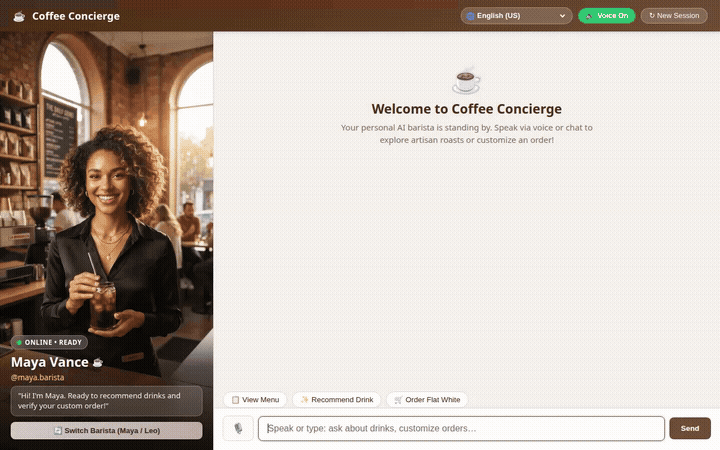

# Coffee Concierge ☕

An intelligent specialty coffee concierge AI agent built with the Google Agent Development Kit (ADK) and Gemini 2.5 Flash on Google Cloud. The agent helps customers explore artisan coffee menus, verifies dietary allergies, creates custom drink visuals on demand, tracks orders, finds nearby cafes, and converts prices across global currencies.



---

## 🌟 What This Agent Does

The agent acts as an artisan barista and coffee specialist with real, working integrations across Google Cloud and public APIs:

- **Browse Menu & Pricing**: Queries specialty coffee and bakery items with category filters (`espresso`, `cold_brew`, `pourover`, `bakery`) directly from Google Cloud Firestore.
- **Dietary & Allergen Memory**: Utilizes Vertex AI Memory Bank (`load_memory`) to retrieve and retain user allergies, sensitivities, and roast preferences across conversational sessions, ensuring safe recommendations.
- **On-Demand Specialty Drink Visuals**: Generates high-quality photorealistic drink and pastry photography via `gemini-3.1-flash-lite-image` on Vertex AI and automatically uploads generated assets to Google Cloud Storage.
- **Interactive UI (A2UI)**: Returns structured A2UI component schemas (cards, imagery, columns, and action buttons) for rich rendering in the chat interface.
- **Order Placement & Tracking**: Creates unique customer orders written into Firestore (`orders` collection) and checks live fulfillment status.
- **Local Cafe Discovery & Geocoding**: Geocodes customer addresses and performs radius searches for nearby cafes and bakeries using the Google Places API.
- **Live Currency Conversion**: Converts USD menu prices to global currencies (EUR, GBP, JPY, CAD, AUD, etc.) with real-time exchange rates.
- **Specialty Coffee Guide**: Fetches brewing methods, ingredients, and flavor descriptions for traditional coffee drinks.
- **Secure Code Sandbox Execution**: Runs dynamic recipe ratios, extraction math, and nutritional calculations safely inside Vertex AI Agent Engine Sandbox Code Executor.

---

## 🛠️ Implemented Tools & Google Cloud Services

Based on `app/agent.py` and `agents-cli-manifest.yaml`:

| Service / Tool | Implementation | Description |
|---|---|---|
| **Gemini 2.5 Flash** | `google.adk.models.Gemini` | Primary conversational reasoning model. |
| **Vertex AI Memory Bank** | `google.adk.tools.load_memory` | Cross-session memory for customer allergies, dietary preferences, and taste profiles. |
| **Google Cloud Firestore** | `google.cloud.firestore` | Document database for live `menu_items` catalog and `orders` management. |
| **Google Cloud Storage** | `google.cloud.storage` | Storage bucket hosting generated beverage and bakery images with public CDN URLs. |
| **Vertex AI Image Generation** | `gemini-3.1-flash-lite-image` | On-demand specialty beverage photography via Vertex AI (`generate_item_image`). |
| **Agent Engine Code Sandbox** | `AgentEngineSandboxCodeExecutor` | Isolated Python execution environment for recipe formulas and extraction calculations. |
| **A2UI Protocol** | `A2uiSchemaManager` + `a2ui_callback` | Emits structured display cards, tables, and media components in responses. |
| **Google Maps & Places APIs** | `geocode_address` + `find_nearby_places` | Geocoding and geographic search for nearby coffee establishments. |
| **Currency Exchange API** | `convert_currency` | Live FX rates for international menu pricing. |
| **Coffee Guide API** | `lookup_coffee_guide` | Reference database for coffee beverage history, ingredients, and recipes. |

---

## 🚀 Local Setup & Running Instructions

### 1. Prerequisites
- Python 3.11+
- [uv](https://docs.astral.sh/uv/) package manager
- Google Cloud SDK (`gcloud`) authenticated to your GCP project
- Node.js (for frontend chat interface)

### 2. Install Dependencies
```bash
cd coffee-concierge
agents-cli install
```

### 3. Launch the Agent Backend / Playground
You can test the agent locally using the ADK dev UI:
```bash
agents-cli playground
```

### 4. Launch the Custom Chat Frontend
The repository includes a custom web frontend with speech recognition, audio synthesis, and live A2UI card rendering:
```bash
cd frontend
python3 main.py
```
*The service listens on the configured local port (default: port 8080).*

---

## 📁 Repository Structure

```
.
├── app/
│   ├── agent.py               # Agent definition, system instructions, and tool functions
│   ├── a2ui_utils.py          # A2UI schema manager and response callbacks
│   └── fast_api_app.py        # FastAPI server entrypoint
├── frontend/
│   ├── main.py                # FastAPI proxy server connecting to Agent Engine over A2A
│   └── static/
│       ├── index.html         # Multilingual chat UI, voice synthesis & STT, AI persona avatars
│       └── ...                # Static media assets and avatar photography
├── demo.gif                   # Looping recording of the agent in action
├── agents-cli-manifest.yaml   # ADK agent deployment manifest (region: us-east1, A2A enabled)
└── pyproject.toml             # Project dependencies and environment specification
```
